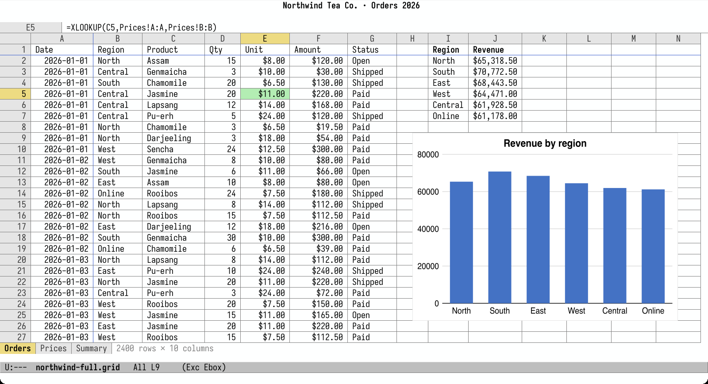
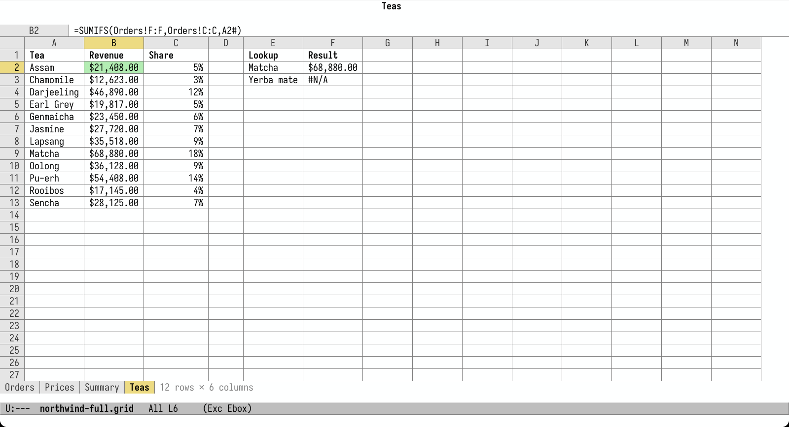
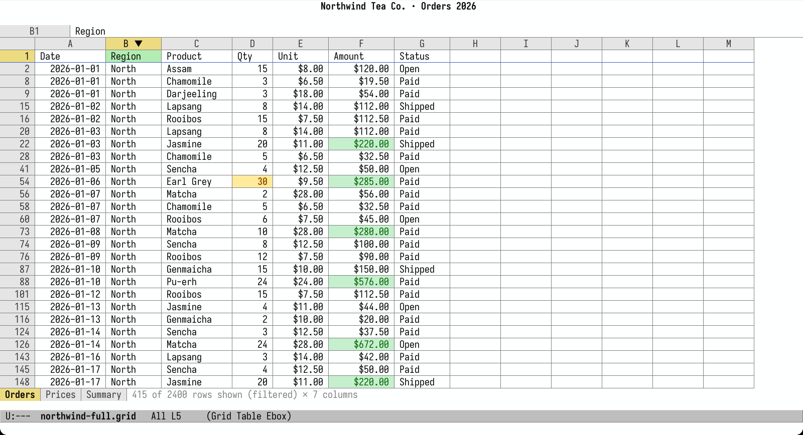
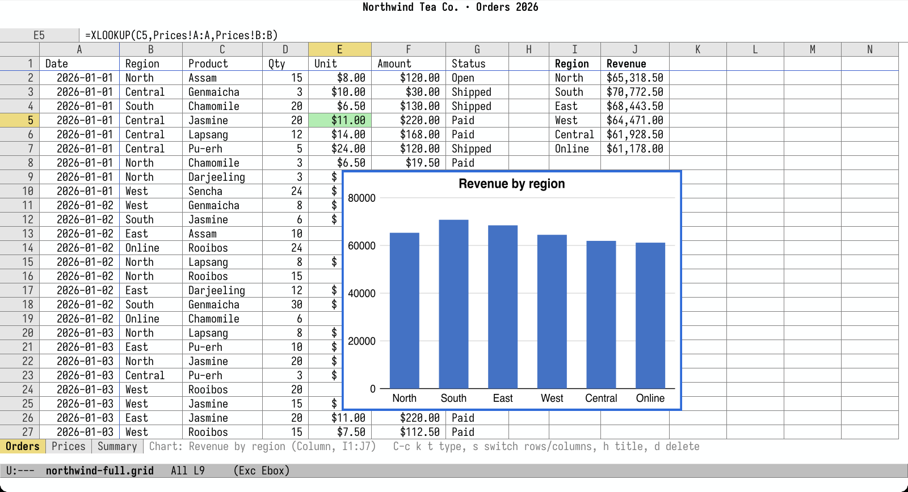
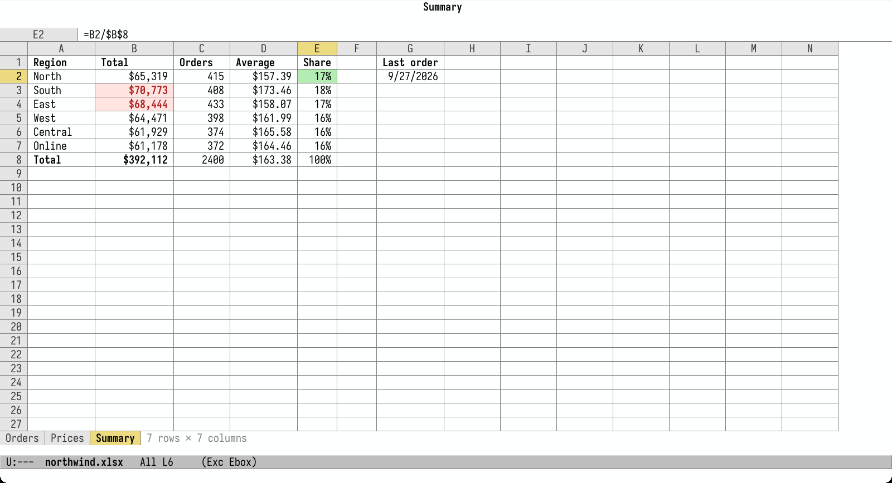

[English](README.md) | [中文](README_CN.md)

# exc.el

A spreadsheet inside Emacs: cells edited in place, Excel-style formulas,
several sheets, formats, filters, floating charts, and xlsx files opened
and written back.

The package was called grid-table up to 0.5.0, and is exc.el from 0.5.1. The old names still work and
are marked obsolete; [Migrating from grid-table](#migrating-from-grid-table)
says what to change.

<div align="center">



</div>

## What it is

exc.el keeps a table in a `.grid` file and shows it as a spreadsheet,
drawn with [ETAF](https://github.com/emacs-taf). It behaves the way people
who use Excel expect, and keeps Emacs habits where they apply:

- **Editing**: type to replace a cell, `F2` or `RET` to edit it, `RET` to
  store and move down, `TAB` to store and move right. After typing, the
  arrow keys store the text and move the way they point; one `ESC` or
  `C-c C-k` throws the edit away again. `C-x C-s` saves.
- **Formulas**: about 470 Excel functions, with cell and range references,
  references to other sheets, names, dynamic arrays that spill, and Excel's
  error values. Results are checked against a corpus of real Excel files.
  `CALC` adds symbolic math through Emacs Calc.
- **Workbooks**: several sheets with tabs, frozen panes, hidden rows and
  columns, filters, sorting, merged cells, notes, links and list validation.
- **Formats**: bold, italic, colors, alignment, number formats (thousands,
  percent, currency, date, text) and conditional formats.
- **Charts**: floating charts (column, bar, line, area, pie, doughnut,
  scatter) that sit over the cells as a layer and move to the pixel, plus
  chart formulas drawn inside a cell.
- **Other formats**: xlsx both ways, CSV, and grid previews in Org,
  Markdown and reStructuredText.

Only the rows and columns that fit the window are drawn, so a sheet of
thousands of rows opens and scrolls without drawing all of it.

## Installation

exc.el needs Emacs 29.1 or later and three libraries from
[emacs-taf](https://github.com/emacs-taf): `ecss`, `ebox` and `etaf`.
None of them is on a package archive yet, so clone all four:

```sh
git clone https://github.com/yibie/exc.el.git
git clone https://github.com/emacs-taf/ecss.git
git clone https://github.com/emacs-taf/ebox.git
git clone https://github.com/emacs-taf/etaf.git
```

Then put them on `load-path`:

```elisp
(dolist (dir '("~/src/ecss" "~/src/ebox" "~/src/etaf"
               "~/src/exc.el" "~/src/exc.el/plugins"))
  (add-to-list 'load-path (expand-file-name dir)))

(require 'exc)
(require 'exc-xlsx)  ; xlsx workbooks (optional)
(require 'exc-csv)   ; CSV files (optional)
(require 'exc-org)   ; grids in Org (optional)
```

Or with `use-package`:

```elisp
(use-package exc
  :load-path ("~/src/exc.el" "~/src/exc.el/plugins")
  :init
  (dolist (dir '("~/src/ecss" "~/src/ebox" "~/src/etaf"))
    (add-to-list 'load-path (expand-file-name dir)))
  :config
  (require 'exc-xlsx))
```

Then byte-compile all four.  Uncompiled, moving around a grid is about
ten times slower, slow enough that a held arrow key outruns the display;
opening a grid warns when they are not compiled.

```sh
make -C ~/src/ecss compile
make -C ~/src/ebox compile
make -C ~/src/etaf compile
make -C ~/src/exc.el compile ETAF_SRC=$HOME/src
```

Compile again after every pull, so a stale `.elc` file is not loaded in
place of the new source.  If `ecss`, `ebox` or `etaf` is missing, opening
a grid says which one.

### The xlsx module

xlsx files are read and written by a dynamic module written in Rust
(`plugins/xlsx/`), so Emacs must be built with module support.
`plugins/exc-xlsx-module.dylib` is a prebuilt module for macOS
(Apple silicon and Intel). On other systems build it with
`M-x exc-xlsx-build-module` or `make module`, which needs
[cargo](https://rustup.rs). A module you build is used in place of the
prebuilt one, and `exc-xlsx-module-file` can name a module kept
elsewhere.

## Getting started

1. `C-x C-f data.grid`. A file that does not exist yet opens as an empty
   grid. `M-x exc-xlsx-find-file` opens an xlsx workbook, and
   `M-x exc-find-file-csv` a CSV file, whose first line is the
   grid's first row; `C-x C-s` writes it back as CSV.
2. Move with the arrow keys or `C-n`/`C-p`/`C-f`/`C-b`. Type to replace
   the cell under the cursor; press `RET` to store it and move down.
3. Type a formula: `=SUM(B2:B10)`, `=B2*$C$1`, `=XLOOKUP(A2,Items!A:A,Items!C:C)`.
   The formula bar above the grid shows what the cell holds.
4. Select with `S-<arrow>`, then `C-c f $` for currency or `C-c f b` for
   bold. Select a block of data and press `C-c i` to insert a chart.
5. `C-x C-s` saves. `C-/` undoes and `C-?` redoes everything above,
   including formats and charts.

## Common keys

The keys below are the ones used every day. [docs/KEYS.md](docs/KEYS.md)
lists every key.

| Action | Keys |
|---|---|
| Edit the cell / store and move down / store and move right | `F2` or `RET` / `RET` / `TAB` |
| New line inside a cell while editing / cancel editing | `M-RET` / `C-c C-k` or `ESC` |
| Store and move, after starting the edit by typing | `<arrow>` |
| Select a range / select everything | `S-<arrow>` / `C-x h` |
| Go to a cell, range or name (`D120`, `A1:B3`, `Sheet2!A1`) | `C-c g` |
| Copy / cut / paste | `M-w` / `C-w` / `C-y` |
| Paste values / formats / transposed | `C-c y v` / `C-c y f` / `C-c y t` |
| Fill down / right / continue a series | `C-d` / `C-r` / `C-c C-s` |
| Clear the selection | `DEL` |
| Undo / redo | `C-/` / `C-?` (while editing, undo takes back the typing; a typed-in edit goes in one step) |
| Find / replace | `C-s` / `M-%` |
| Insert row above / add row below / delete row | `C-c r i` / `C-c r a` / `C-c r d` |
| Add column / delete column | `C-c c a` / `C-c c d` |
| Bold / italic / text color / fill color | `C-c f b` / `C-c f i` / `C-c f c` / `C-c f g` |
| Number / percent / currency / date format | `C-c f ,` / `C-c f p` / `C-c f $` / `C-c f d` |
| Merge / unmerge | `C-c m` / `C-c u` |
| Sort / filter the column / clear all filters | `C-c s` / `C-c / f` / `C-c / a` |
| Freeze panes at the cursor / unfreeze | `C-c w f` / `C-c w u` |
| Next / previous sheet / new sheet | `C-<next>` / `C-<prior>` / `C-c w n` |
| Insert chart / move it to the cursor | `C-c i` / `C-c k m` |
| Save / save as | `C-x C-s` / `C-c C-w` |
| Recalculate everything / quit | `C-c C-r` / `C-c C-q` |

With the mouse: click a cell to go there, shift-click or drag to select,
click a row number, a column letter or the corner to select a row, a
column or the whole sheet, and drag the right edge of a column letter to
change its width. Dragging a selection or a chart to the edge of the
window scrolls the sheet.

### Prefer the keyboard to the mouse

On macOS the window system sometimes never hands Emacs the release of the
mouse button. The drag then goes on after the button is up: a selection
keeps following the pointer, or a chart keeps moving, until the next
click. exc.el hides tooltips during a drag, which makes this rare, but
it can still happen ([ebox#1](https://github.com/emacs-taf/ebox/issues/1)).
If it does, click once or press `Esc`; `C-/` undoes a chart moved by
mistake.

| Instead of dragging to… | Use |
|---|---|
| Select a range | `S-<arrow>`, or `C-x h` for the whole sheet |
| Move a chart | Put the cursor on a cell, then `C-c k m` |
| Resize a chart | `C-c k z` |
| Pick a chart | `C-c k n` |

Column widths can so far be changed only by dragging a column's edge.

## Formulas

<div align="center">



</div>

A cell starting with `=` holds a formula. Function names and references
may be typed in either case.

| Kind | Syntax | Example |
|---|---|---|
| Cell, range | `A1`, `A1:B5` | `=B2*C2`, `=SUM(A1:A10)` |
| Fixed column or row | `$A$1`, `A$1` | `=B2*$C$1` |
| Whole columns or rows | `A:A`, `2:5` | `=SUM(B:B)` |
| Another sheet | `Sheet2!A1`, `'My Sheet'!A1` | `=SUM(Sheet2!A1:B5)` |
| Spilled range | `C1#` | `=SUM(C1#)` |
| Name | defined with `C-c n d` | `=SUM(Sales)`, `=Twice(A2)` |
| Operators | `+ - * / ^ & %` and `= <> < > <= >=` | `=A1&" kg"`, `=B2*15%` |

What to expect:

- **Values.** What is typed is read as it was meant: `2026-10-13` is a
  date, `12.5%` is 0.125, `$1,234.50` is 1234.5, each shown as typed. A
  date with slashes and the year last is read month first (`3/4/2026` is
  March 4). Start a cell with `'` (`'007`) to keep it as text. A number
  without a format is shown as Excel's general format shows it, in eleven
  characters at most, while every digit is kept.
- **Dynamic arrays.** `UNIQUE`, `SORT`, `FILTER`, `SEQUENCE` and the like
  spill their results into the cells below and beside them; `#SPILL!`
  shows when those cells are not empty. Comparisons and arithmetic on a
  range go cell by cell, so `=SUM((A2:A9="x")*B2:B9)` works.
- **Errors.** `#DIV/0!`, `#NAME?`, `#N/A`, `#REF!`, `#VALUE!`, `#NUM!`,
  `#CALC!`, `#SPILL!` and `#CYCLE!` (a circular reference) show in the
  cell and in the cells that read it. `IFERROR` replaces them.
- **Recalculation.** An edit recomputes the cell and the formulas that
  depend on it, in dependency order. Formulas reading another sheet or
  calling `TODAY`, `NOW` or `RAND` are recomputed at every edit.
  `C-c C-r` computes everything anew.
- **Tracing.** `C-c a p` marks the cells the formula under the cursor
  reads, `C-c a d` the formulas that read the cell, `C-c a n` visits them
  and `C-c a x` clears the marks.
- **Where it differs from Excel.** A sheet is as large as its rows and
  columns, so on a sheet of 20 rows `A:A` is those 20 cells and
  `=ROWS(A:A)` is 20. Sorting moves a formula with its row, including
  references that name the sheet itself.

### Symbolic math with Emacs Calc

`CALC` hands its text to Emacs Calc and shows what Calc gives back, so a
cell can take a derivative, integrate, factor or find roots:

| Formula | Value |
|---|---|
| `=CALC("deriv(x^2 + 3 x, x)")` | `2 x + 3` |
| `=CALC("integ(sin(x), x)")` | `-cos(x)` |
| `=CALC("factor(x^2 - 5 x + 6)")` | `(x - 2) (x - 3)` |
| `=CALC("roots(x^2 - 5 x + 6, x)")` | `[3., 2.]` |
| `=CALC("nrat((x^2 - 1) / (x - 1))")` | `x + 1` |
| `=CALC("deriv(" & A2 & ", x)")` | the derivative of the expression in A2 |

The text is in Calc's algebraic notation. Calc runs in radians at 15
digits, whatever your own Calc is set to. A number comes back as a number
(`=CALC("2^10")*2` is 2048); anything else, or a number too large for a
double, comes back as text. Text Calc cannot read is `#VALUE!`. Unlike
`=elisp:`, `CALC` needs no leave to run: Calc's notation reaches only its
own math functions. It is exc.el's own function, so Excel shows
`#NAME?` for it.

Calc computes in other Emacsen, started the first time `CALC` is used
and kept, so a long computation does not hold yours. There are up to
`exc-calc-calc-workers` (2) of them, so a slow computation holds only
its own and the others go on with the rest. Until its answer
comes a cell shows `#GETTING_DATA`; then it and the formulas that read it
are computed again. A computation that takes longer than
`exc-calc-calc-timeout` (10 seconds) is stopped and shows `#CALC!`.
Answers are kept, so the same text is not computed twice, and `random()`
does not change; `C-c C-r` computes them all anew. They start
with `-Q`, so Calc functions you defined with `defmath` are not
there. In batch, or with `exc-calc-calc-async` set to nil, Calc
computes in your Emacs and the answer is there at once.

### Lisp formulas

`=elisp:(+ (cell "A1") (cell "B2"))` runs Emacs Lisp. It is off by
default, since a grid file could run any code: set
`exc-allow-elisp` to `t` only for files you trust. See
[docs/ELISP_FORMULA_GUIDE.md](docs/ELISP_FORMULA_GUIDE.md).

## Formats, filters and sheets

<div align="center">



</div>

- **Formats** apply to the selection and move with their cells when rows
  and columns are inserted, deleted or sorted. `C-c f n` adds a
  conditional format ("greater than 100" in red, "contains", "is blank",
  "is an error") that follows the values.
- **Filters**: `C-c / f` filters by a condition on the cursor's column,
  `C-c / v` keeps the rows holding the cursor cell's value, `C-c / d`
  removes duplicate rows. A filtered column shows `▼` after its letter,
  and moving, copying, clearing and the status bar figures pass over the
  rows a filter hides.
- **Sorting**: `C-c s` sorts by what a column shows, numbers before text
  and empty cells last; `C-u C-c s` adds columns to break ties.
- **Header row**: the first row stays in place when sorting and filtering.
  `C-c w h` turns that off for a sheet that is not one table.
- **Merged cells**: `C-c m` merges the selection, which can be a row, a
  column or a rectangle. `M-RET` adds a line inside a cell while editing.

<div align="center">


</div>

- **Sheets**: `C-c w n` adds one, `C-c w r` renames, `C-c w d` deletes,
  `C-c w <` and `C-c w >` move it; the tabs on the bottom line can be
  clicked. Each sheet keeps its own cursor, filters and undo history.
- **Frozen panes**: `C-c w f` freezes the rows above the cursor and the
  columns left of it.
- **Hidden rows and columns**: `C-c r h` / `C-c c h` hide the selection's
  rows or columns, `C-c r s` / `C-c c s` show the hidden ones inside it.
- **Notes and links**: `C-c ;` gives a cell a note (a red right edge marks
  it), `C-c C-l` a link to a web address, a file or `#Sheet2!A1`, which
  `C-c C-o` follows.
- **List validation**: `C-c f v` lets the selected cells take only listed
  values (`Yes, No`, or a range such as `=$F$2:$F$9`); editing such a cell
  offers them.

The cursor and the selection go past the last row and column, as in a
spreadsheet, and writing there makes the sheet grow to hold it.

## Charts

### Floating charts

<div align="center">



</div>

Select a block of data (or put the cursor in it), press `C-c i` and pick
a type: column, stacked column, bar, stacked bar, line, area, pie,
doughnut or scatter. The chart floats over the cells and redraws when
they change.

- A first row of text names the series and a first column of text names
  the categories. `C-c k s` switches rows and columns.
- Click a chart to select it and drag it to move it. It moves to the
  pixel across and by lines down, and stays where it is let go.
- `Esc`, `C-c k x`, or a click on a cell takes the selection off a
  chart, and so does starting to edit a cell. The arrow keys keep it, so
  `C-c k m` can move the chart to the cursor.
- Inserting or deleting rows and columns moves a chart with its cells. A
  chart anchored in frozen rows or columns stays put along that axis.
- Charts are saved in the `.grid` file and written to xlsx as the
  workbook's own charts.
- Where images cannot be shown, as in a terminal, a chart is a text sketch.

| Action | Keys |
|---|---|
| Insert chart | `C-c i` |
| Type / switch rows and columns / title | `C-c k t` / `C-c k s` / `C-c k h` |
| Draw the selected cells instead | `C-c k r` |
| Move to the cursor / resize | `C-c k m` / `C-c k z` |
| Select next chart / deselect / delete | `C-c k n` / `C-c k x` / `C-c k d` |

### Chart formulas

A chart formula draws a small chart inside its cell, out of Unicode
blocks and Braille dots; `C-c v` opens it in its own buffer.
`M-x exc-insert-chart` inserts one.

| Function | Chart |
|---|---|
| `BARPLOT(labels, values, [title], [width])` | Horizontal bars |
| `COLUMNPLOT(labels, values, [title], [width], [height])` | Vertical columns |
| `LINEPLOT(x, y, [title], [width], [height])` | Line |
| `SCATTER(x, y, [title])` | Scatter |
| `HISTOGRAM(values, [bins], [title], [width])` | Histogram |
| `BOXPLOT(series1, series2, …, [title], [width])` | Box plot |
| `DENSITY(values, [title])` | Density curve |
| `COUNTPLOT(values, [title])` | Counts of each value |
| `MULTILINE(x, series1, series2, …, [title])` | Several lines |
| `SPARKLINE(range)` or `SPARKLINE(v1, v2, …)` | Small trend line |

<table>
<tr>
<td></td>
<td></td>
<td></td>
<td></td>
</tr>
<tr>
<td></td>
<td></td>
<td></td>
<td></td>
</tr>
<tr>
<td></td>
<td></td>
</tr>
</table>

`examples/chart-gallery.grid` shows each of them.

## Excel workbooks (xlsx)

<div align="center">



</div>

`(require 'exc-xlsx)` adds two commands:

| Command | What it does |
|---|---|
| `M-x exc-xlsx-find-file` | Open a workbook, with a sheet for each of its sheets |
| `M-x exc-xlsx-export` | Write the grid and all its sheets to a workbook |

A grid opened from a workbook is not tied to it: `C-x C-s` saves a
`.grid` file, and exporting writes the workbook.

Both ways: values, formulas, number formats, merges, bold, italic,
colors, alignment, conditional formats, column widths, frozen panes,
hidden rows and columns, list validations, workbook names, notes, links,
charts (column, bar, line, area, pie, doughnut and scatter, including
how far into a column a chart starts), and each sheet's grid title, kept
in the workbook's custom properties where Excel leaves it alone.

Not carried, or changed on the way:

- Borders, fonts, other kinds of conditional format and validation, and
  names belonging to one sheet are left out on import. On export, the
  cells, merges, notes, conditional formats, validations and hidden lines
  of a sheet are replaced by the grid's, so those left out are gone; the
  rest of the sheet and the other sheets stay as they were.
- A number format exc.el has no counterpart for is shown in the
  general format and written back unchanged.
- A formula using a function exc.el lacks shows an error value but is
  kept and exported as written.
- Other kinds of chart (radar, 3-D, ones reading another sheet) are not
  imported and are written back as they were. Chart formulas are exported
  as text.
- Dates before March 1900 are a day off, as the workbook's calendar has a
  February 29 that year.
- Written back to the workbook it came from, the grid's sheets replace the
  workbook's; written into another, they are added to it.

## Org, Markdown and reStructuredText

**Org**: `M-x exc-org-insert-block` inserts a source block that
previews a `.grid` file. Inside the block, `M-x exc-org-refresh-block`
draws the preview again from the file and `M-x exc-org-open-block`
opens the grid.

```org
#+BEGIN_SRC exc :file /home/me/project/data.grid
| Region | Total |
|--------+-------|
| North  | 120   |
#+END_SRC
```

**Markdown**: `M-x exc-markdown-insert-block` inserts a fenced
block the same way, with `exc-markdown-refresh-block` and
`exc-markdown-open-block` for the block at point.

````markdown
```exc file=/home/me/project/data.grid
┌───┬────────┬───────┐
│   │ A      │ B     │
…
```
````

A path with spaces is written in double quotes.

**reStructuredText**: `M-x exc-export-as-rst` writes a grid as an
RST table, and `M-x exc-rst-insert-table-from-file` inserts one
from a `.grid` file.

The previews are plain-text tables drawn by `exc-text.el`, which
needs no ETAF.

## Migrating from grid-table

The package was called grid-table up to 0.5.0, and is exc.el from 0.5.1.
Every grid-table name still works, marked obsolete, and will be removed
in a later version.

- **Loading.** Change `(require 'grid-table)` to `(require 'exc)`. The old
  form still loads the package and says so.
- **Plugins.** The old feature names are gone: `(require 'grid-table-xlsx)`
  and the rest fail. Use `exc-xlsx`, `exc-csv`, `exc-org`, `exc-markdown`,
  `exc-rst` and `exc-example-plugin`.
- **`.grid` files.** This version reads what 0.5.0 wrote. A file 0.5.1
  saves starts with `exc-file`, which 0.5.0 and earlier cannot read, so keep
  the old version's copy if you may need to go back.
- **Org and Markdown blocks.** A block whose language is the old
  `grid-table`, and a fence that still says `grid-view`, are recognised and
  refreshed as before; blocks inserted now say `exc`.
- **xlsx.** A grid title kept in a workbook by an older version is still
  read, and saving writes the new property name.
- **Customize.** A value set on an old variable name reaches the new one, so
  a `custom-file` written for 0.5.0 still applies. Rename those entries when
  convenient: the old names are marked obsolete and will go away.
- **Building.** The Makefile targets are unchanged, but the module and its
  file are named after the package: `plugins/exc-xlsx-module`, built from
  `plugins/xlsx/` by `make module` or `make module-dist`. `ETAF_SRC` means
  what it did.

## Development

```
exc.el                    entry point, commands, file handling
exc-etaf.el               the spreadsheet view (ETAF)
exc-data-model.el         cells, rows, sheets
exc-data-source.el        data source interface
exc-calc*.el              formula parser and functions
exc-format.el             number formats
exc-persistence.el        the .grid file format
exc-text.el               plain-text tables for previews and export
exc-chart*.el             chart formulas and floating charts
plugins/                   CSV, xlsx (with the Rust module), Org, Markdown, RST
test/                      ERT tests and the formula corpus
docs/                      key reference, Lisp formulas, plugins
examples/                  sample grids
```

Run the tests with:

```sh
make test-model                      # model, formulas, text tables
make test-xlsx                       # xlsx import and export
make test-etaf ETAF_SRC=~/src        # the view; ETAF_SRC holds ecss, ebox and etaf
```

`test/corpus/` compares formula results against values saved by Excel in
a corpus of real workbooks; `make corpus-fetch` downloads it.

Plugins can add data sources and file formats; see
[docs/PLUGIN_DEVELOPMENT.md](docs/PLUGIN_DEVELOPMENT.md) and
`plugins/exc-example-plugin.el`.

Bugs and suggestions: [GitHub Issues](https://github.com/yibie/exc.el/issues).
Problems in drawing or mouse handling may belong to
[ETAF](https://github.com/emacs-taf).
