[English](README.md) | [中文](README_CN.md)

# 🎯 grid-table - Emacs 高端表格系统

<div align="center">

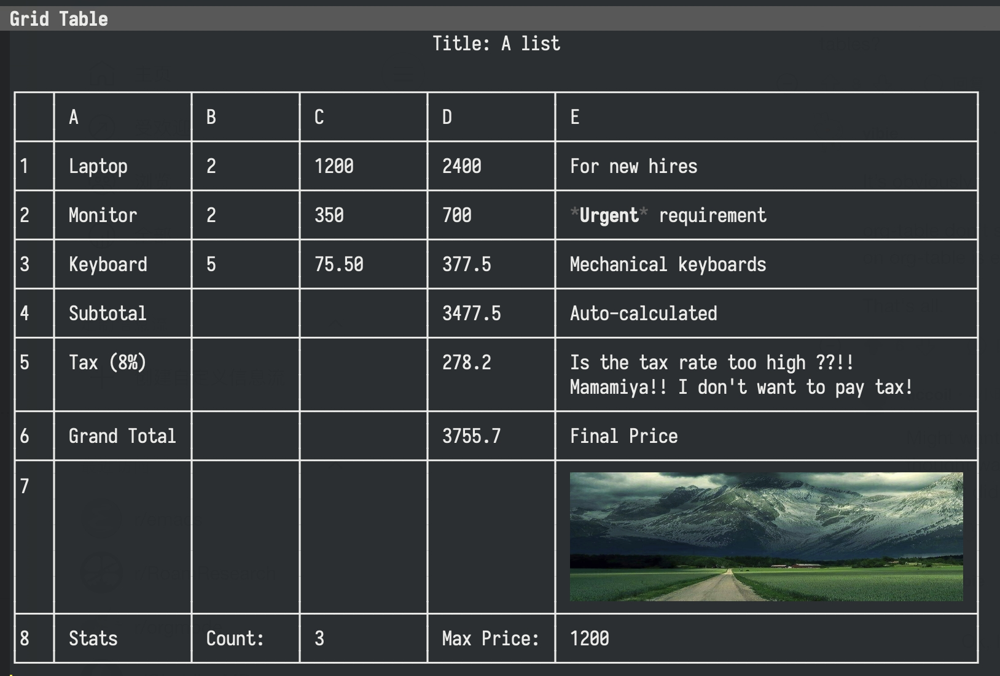

<p><i>为 Emacs 源生打造的表格系统！支持富文本、公式计算和插件扩展 🔥</i></p>

</div>

## ✨ 功能亮点

<div align="center">

| 外观体验                                                    | 数据计算                                                              | 可扩展性                                                   |
| ----------------------------------------------------------- | --------------------------------------------------------------------- | ---------------------------------------------------------- |
| 富文本渲染<br/> 单元格图片<br/> 自适应列宽<br/> Unicode边框<br/> 合并单元格 | 公式引擎 (Excel风格)<br/>📍 单元格引用<br/> 实时计算<br/> Elisp表达式 | 插件架构<br/> 多数据源支持<br/> 格式导出<br/>🔧 自定义扩展 |

</div>

### 🚀 核心能力

- **Markdown风格标记** - 在单元格中写简历总结
- **图片可视化** - 直接在表格中显示图片!
- **Excel级公式** - `=B2*C2· =SUM(A1:A10)· =IF(...)`
- **Elisp超级公式** - 强大的 `=elisp:(cell"A1")` 表达式
- **实时预览** - 在Org/Markdown中"静态预览 + 动态编辑"
- **合并单元格** - 支持横向、纵向跨度与边框感知导航

### ↕️ 合并单元格

<div align="center">

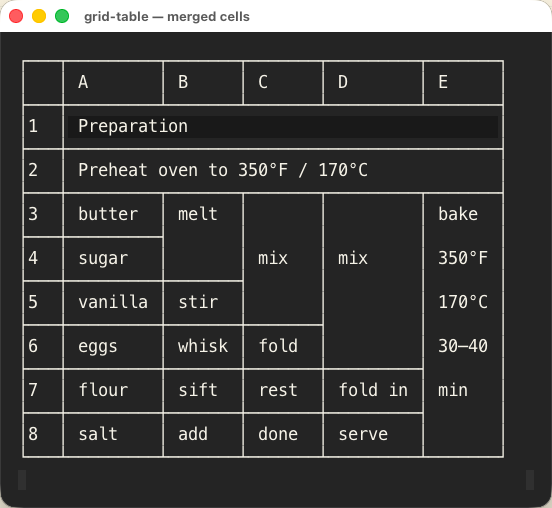

</div>

按 `C-c m` 输入同行或同列的 A1 范围即可合并；按 `C-c u` 取消光标所在的合并。编辑时可用 `M-RET` 输入多行内容。

## 🚀 30秒上手

### 📦 1. 安装配置

#### 🎯 推荐用 `use-package`

```elisp
;; 🚄 一步到位配置 - 推荐！
(use-package grid-table
  :load-path ("/path/to/grid-table" "/path/to/grid-table/plugins")
  :config
  (require 'grid-table)
  (require 'grid-table-plugins)

  ;; 📁 自定义保存目录
  (setq grid-table-default-save-directory "~/Documents/表格/")

  ;; 🖼️ 图片显示调优
  (setq grid-table-image-target-char-height 8)
  (setq grid-table-image-max-width-ratio 0.9))
```

#### 📋 传统方式

```elisp
;; 📍 手动配置路径
(add-to-list 'load-path "/path/to/grid-table")
(add-to-list 'load-path "/path/to/grid-table/plugins")

;; 🎯 按需加载
(require 'grid-table)          ;; 核心功能
(require 'grid-table-plugins)  ;; 插件系统
(require 'grid-table-csv)      ;; CSV支持
(require 'grid-table-org)      ;; Org集成
(require 'grid-table-markdown) ;; Markdown集成
```

#### 🖼️ 渲染器

`grid-table-renderer` 决定表格的绘制方式：

- `etaf`（默认）通过 [ETAF](https://github.com/emacs-taf) 挂载表格。只渲染窗口内可见的行列，单元格原位编辑，`S-<方向键>` 选择范围。需要把 `ecss`、`ebox`、`etaf` 三个仓库加入 `load-path`：

  ```elisp
  (add-to-list 'load-path "/path/to/ecss")
  (add-to-list 'load-path "/path/to/ebox")
  (add-to-list 'load-path "/path/to/etaf")
  ```

  按键遵循电子表格的习惯：直接打字会替换单元格内容并进入编辑，`F2` 或 `RET` 编辑现有内容，`RET` 提交并下移，`TAB` 提交并右移，`C-c C-c` 原地提交，`C-c C-k` 取消。`C-n`/`C-p`/`C-f`/`C-b` 和方向键移动，`DEL` 清空选区，`M-w`/`C-w`/`C-y` 复制、剪切、粘贴选区（连同格式），`C-d`、`C-r` 把选区首行向下、首列向右填充，`C-c C-s` 按序列填充（1、2 → 3、4；日期逐日递增；`Week 1` → `Week 2`），`C-s` 查找下一个包含某文本的单元格（`C-u C-s` 反向），`M-%` 在选区或整张表内替换，`C-/` 撤销，`C-?` 重做，`C-x h` 全选，`C-c C-r` 刷新，`C-c C-q` 退出。鼠标操作：单击单元格移动光标，Shift 单击或拖动选择范围，单击行号、列字母或左上角选择整行、整列或全表，拖动列字母右边缘调整列宽；列宽随表格保存，并跟着所在列移动。粘贴内容超出最后一行或一列时，表格会自动扩展。下文表格里的单字母命令（`e`、`n`、`p`、`g`、`q`）属于 classic 渲染器。

  格式作用于选区：`C-c f b` 加粗，`C-c f i` 斜体，`C-c f c` 文字颜色，`C-c f g` 填充色，`C-c f l`/`e`/`r` 左对齐、居中、右对齐，`C-c f x` 清除。数字格式：`C-c f ,` 带千位分隔的数字，`C-c f p` 百分比，`C-c f $` 货币，`C-c f d` 日期，`C-c f t` 文本，`C-c f G` 常规，`C-c f +`/`-` 增减小数位。`C-c f n` 添加条件格式（例如「大于 100」标红），之后随数值变化自动生效，`C-c f N` 移除与选区相交的条件格式。增删行列和排序时格式跟随单元格移动，并保存在 `.grid` 文件里。带格式的文件以版本 4 写出，旧版本打不开；不带格式的文件仍按原来的旧版本保存。

  选中多个单元格后按 `C-c m` 合并为一格；范围可以是矩形，不限于单行或单列（classic 渲染器把矩形合并显示为分开的单元格）。图表公式直接画在所在单元格里，按图表自身的尺寸撑开行高和列宽；`C-c v` 仍可在独立 buffer 里查看。

  `C-c s` 按列的显示值排序：数字按数值排在文本之前，文本不区分大小写，空白单元格无论升降序都排最后。`C-c / f` 按条件筛选光标所在列，`C-c / v` 只保留与光标单元格值相同的行，`C-c / c` 清除该列的筛选，`C-c / a` 清除全部。多列筛选同时生效，被筛选的列在字母后显示 `▼`，移动、复制、清空、设置格式以及状态栏统计都会跳过隐藏行。筛选在设置时和刷新（`C-c C-r`）时计算，不会在每次编辑后重新计算。

  工作表的第一行默认是表头行：排序和筛选时留在原位，不能删除。`C-c w h` 可以为不是单张数据表的工作表关掉它（顶部有标题、分成几块、带汇总等），之后第一行与其他行无异：参与排序和筛选，可以删除、向下合并，也可以用 `C-c r i` 在它上方插入行。这个设置随表格保存。

  `C-c w f` 冻结光标上方的行和左侧的列：它们固定在窗口顶部和左侧，其余部分照常滚动，分界处有一条彩色线（face `grid-table-etaf-freeze-face`）。`C-c w u` 取消冻结，在第一个单元格按 `C-c w f` 效果相同。在冻结区域内插入的行列会一并冻结。冻结设置随表格保存，装了 xlsx 插件时也随 xlsx 往返；冻结操作本身也不进撤销历史。

  一个表格可以有多张工作表。`C-c w n` 新建，`C-c w r` 给当前工作表改名，`C-c w d` 删除，`C-c w <` 和 `C-c w >` 移动，`C-<next>` 和 `C-<prior>` 切到后一张和前一张，`C-c w s` 按名称选择；用 ETAF 时底部一行有可点击的工作表标签。公式用 `Sheet2!A1`、`SUM(Sheet2!A1:B5)`、`'My Sheet'!A1` 读取其他工作表；工作表改名、那张表增删行列时引用会跟着改，工作表删除后显示 `#REF!`。每张工作表有各自的光标、筛选和撤销历史。只有一张工作表时文件格式不变；有多张时保存为版本 5，旧版本读不了。

- `classic` 用边框字符直接画进 buffer，通过 minibuffer 编辑。它是迁移到 ETAF 期间的兜底选择：ETAF 无法加载时自动使用，迁移完成后移除。它不再增加新功能：选区、原位编辑、格式、筛选、填充、查找替换、冻结窗格、矩形合并和工作表标签只在 ETAF 视图里有。Markdown 预览和各导出器用的纯文本表格在 `grid-table-text.el` 里，不依赖任何一种视图。

运行测试：`make test-classic` 与 `make test-etaf ETAF_SRC=/path/to/checkouts`。

## 📋 操作速查表

### 文件操作一览表

| 🎯 动作 | 📝 命令                        | 🔑 快捷键 | ⚡ 提示       |
| ------- | ------------------------------ | --------- | ------------- |
| 新建    | `M-x grid-table-create`        | -         | 创建空白表格  |
| 打开    | `M-x grid-table-find-file`     | `C-c C-f` | 打开.grid文件 |
| 保存    | -                              | `C-c C-w` | 智能提示路径  |
| CSV     | `M-x grid-table-find-file-csv` | -         | 直接读取CSV   |
| Excel   | `M-x grid-table-xlsx-find-file` | -        | 打开 xlsx 工作簿 |

### 编辑操作速记

| 🎯 动作         | 🤞 快捷键  | 📝 效果        | ⚠️ 备注             |
| --------------- | ---------- | -------------- | ------------------- |
| **✏️ 基础编辑** |            |                |                     |
| 单元格编辑      | `e` 或右键 | 进入编辑模式   | 单元格聚焦          |
| 标题编辑        | `C-c t`    | 修改表格标题   | 全局显示            |
| 合并单元格      | `C-c m`    | 合并 A1 范围   | 仅限同行或同列      |
| 取消合并        | `C-c u`    | 取消当前合并   | 保留锚点值          |
| **➕ 行操作**   |            |                |                     |
| 下方插入行      | `C-c r a`  | 在当前行下新建 | 智能继承格式        |
| 删除当前行      | `C-c r d`  | 快速删除整行   | ⚠️ **表头无法删除** |
| **➕ 列操作**   |            |                |                     |
| 右侧插入列      | `C-c c a`  | 新建空白列     | 自动调宽            |
| 删除当前列      | `C-c c d`  | 整列删除       | 数据清空            |

### 导航控制图

| 🎯 方向 | ⌨️ 按键        | 🖱️ 操作  |
| ------- | -------------- | -------- |
| ⬆️ 向上 | `p` 或 `↑`     | 上一行   |
| ⬇️ 向下 | `n` 或 `↓`     | 下一行   |
| ⬅️ 向左 | `S-TAB` 或 `←` | 左单元格 |
| ➡️ 向右 | `TAB` 或 `→`   | 右单元格 |
| 🔄 刷新 | `g`            | 重新渲染 |

**🎯 小贴士**: 使用 `n`/`p` 垂直移动, `TAB` 快速水平移动

## 🧮 公式完全指南

### 基础语法对照表

| 🎯 类型   | 📝 语法           | 📋 示例            | 💡 说明      |
| --------- | ----------------- | ------------------ | ------------ |
| 📍 单元格 | `=A1`、`=B2`      | `=B2*C2`           | 相对引用     |
| 📊 范围   | `=RANGE(A1:B5)`   | `=SUM(A1:A10)`     | 连续区块     |
| ✨ 函数   | `=FUNCTION(args)` | `=AVERAGE(B2:B10)` | 内置函数集合 |
| 📌 绝对引用 | `=$A$1`、`=A$1` | `=B2*$C$1`         | `$` 让列或行在复制公式时保持不变 |
| ➗ 运算符 | `+ - * / ^ & %`   | `=A1&" kg"`、`=B2*15%` | 算术、乘方与文本连接；`=10/4` 得 `2.5`；数值后的 `%` 表示除以 100（取余数用 `MOD(7,3)`） |
| 📏 整列整行 | `=A:A`、`=2:5`    | `=SUM(B:B)`        | 整列或整行，直到工作表边缘 |
| ⚖️ 比较   | `= <> < > <= >=`  | `=IF(A1<=5,"low","high")` | 数字按数值比较，文本不区分大小写；`TRUE`/`FALSE` 是字面量 |

单元格存的是数值，显示时套用格式。输入会按本意识别：`2026-10-13`（或 `2026/10/13`，可带时间）存为日期，`12.5%` 存为 0.125，`$1,234.50` 存为 1234.5，显示仍是输入时的样子；`10/13/2026` 这类其他顺序不做猜测，保持为文本。日期是天数，所以 `=A2+7` 就是一周后（用 `C-c f d` 给该单元格设日期格式）；以 `TODAY`、`NOW`、`DATE`、`EDATE`、`EOMONTH`、`DATEVALUE` 开头的公式会自动按日期显示。另有 `YEAR`、`MONTH`、`DAY`、`WEEKDAY`、`DAYS`、`TEXT`、`VALUE`。旧表格里以文本保存的日期不会被改动，可用 `DATEVALUE` 转成日期。在百分比格式的单元格里直接输入数字，就是这么多个百分点（`50` 即 50%）。以撇号开头（`'007`）可让单元格保持为文本。

函数名和引用大小写均可。`SUM`、`AVERAGE`、`COUNT`、`COUNTA`、`MAX`、`MIN` 接受任意多个数值和范围（`=SUM(A1:A5,C1,10)`）。`IF` 只计算选中的分支，所以 `=IF(B2=0,0,A2/B2)` 是安全的。`ROUND` 四舍五入（逢五远离零）。`XLOOKUP(查找值, 查找范围, 返回范围, 找不到时的值)` 做精确匹配；`VLOOKUP` 省略第四个参数时把首列当作已排序，取不超过查找值的最后一行，给 `FALSE` 时精确匹配。另有 `MEDIAN`、`LARGE`、`SMALL`、`RANK`、`SUMPRODUCT`、`TRUNC`、`FLOOR`、`CEILING`、`MROUND`。算术运算把空单元格当 0，把像数字或日期的文本当作对应的数；其他文本会让公式显示 `#VALUE!`，不再悄悄当 0。`SUM` 等聚合函数跳过文本，包括存为文本的数字。排序时公式跟着所在行移动，行内的 `=B2*2` 排序后仍然读自己这一行；带本表表名的引用也一样（在「订单」表里的 `=订单!B2*2`，Excel 会让它留在原来的行），而指向其他工作表的引用保持不动，因为那些表没有排序。公式按依赖顺序计算，与它在表中的位置无关。一次编辑只重算这个单元格、读它的公式以及再读这些公式的公式；读取其他工作表、调用 `TODAY`、`NOW` 或 grid-table 之外定义的函数、或运行 Lisp 的公式每次编辑都会重算。`C-c C-r` 全部重新计算。无法计算的公式会在自己的单元格以及引用它的单元格里显示错误值：`#DIV/0!`、`#NAME?`（未知函数）、`#N/A`（无匹配）、`#REF!`、`#VALUE!`（需要数字的地方是文本）、`#NUM!`、`#CYCLE!`（循环引用）或 `#ERROR!`。用 `IFERROR` 包住公式可以替换错误值。

### 官方内置函数大全

| 📈 数学函数    | 📊 统计函数    | 🎯 条件函数   | 🎨 文本函数       |
| -------------- | -------------- | ------------- | ----------------- |
| `SUM` 求和     | `AVERAGE` 平均 | `IF` 条件判断 | `CONCAT` 连接     |
| `PRODUCT` 乘积 | `COUNT` 计数   | `AND/OR` 逻辑 | `LEFT/RIGHT` 切片 |
| `MOD` 取模     | `MAX/MIN` 极值 | `NOT` 反转    | `LEN` 长度        |

### Elisp公式高级技巧 (专家级别)

```elisp
=elisp:(+ 1 2 3)                      ; 🎯 基础计算
=elisp:(+ (cell "A1") (cell "B2"))     ; 📍 单元格引用
=elisp:(format "%.2f%%" (* 100 (cell "完成率"))) ; 🎨 带格式字符串
=elisp:(let ((x (cell "B2"))) (* x x)) ; 🔧 复杂逻辑
```

该功能默认不开启，更详细的指南，麻烦查看 [ELISP_FORMULA_GUIDE.md](docs/ELISP_FORMULA_GUIDE.md)。

> ⚠️ **安全提醒**: `=elisp:` 执行任意Elisp代码！**仅在完全信任的文档中使用**
> 🔒 **建议**: 通过 `M-x checkdoc` 验证外部文件安全可靠

## 📊 图表可视化指南

grid-table 内置图表公式功能，可直接在单元格中渲染 ASCII/Unicode 图表。图表使用高分辨率 Braille Canvas 技术，提供精美的终端可视化效果。

### 可用图表函数

| 📊 图表类型 | 📝 函数名    | 💡 说明              |
| ----------- | ------------ | -------------------- |
| 条形图      | `BARPLOT`    | 水平条形图           |
| 柱状图      | `COLUMNPLOT` | 垂直柱状图           |
| 折线图      | `LINEPLOT`   | Braille 渲染的折线图 |
| 散点图      | `SCATTER`    | 散点图可视化         |
| 直方图      | `HISTOGRAM`  | 分布直方图           |
| 箱线图      | `BOXPLOT`    | 统计箱线图           |
| 密度图      | `DENSITY`    | KDE 密度曲线         |
| 频率图      | `COUNTPLOT`  | 频率统计图           |
| 多线图      | `MULTILINE`  | 多系列折线图         |
| 迷你图      | `SPARKLINE`  | 紧凑的内联趋势线     |

### 图表语法示例

#### BARPLOT - 水平条形图

```
=BARPLOT(标签范围, 数值范围, [标题], [宽度])
```

**示例：**

```
=BARPLOT(A1:A4, B1:B4, "季度收入", 50)
```

#### COLUMNPLOT - 垂直柱状图

```
=COLUMNPLOT(标签范围, 数值范围, [标题], [宽度], [高度])
```

**示例：**

```
=COLUMNPLOT(A1:A4, B1:B4, "月销售额", 40, 15)
```

#### LINEPLOT - 折线图

```
=LINEPLOT(X数据, Y数据, [标题], [宽度], [高度])
```

**示例：**

```
=LINEPLOT(A1:A10, B1:B10, "趋势分析")
```

#### HISTOGRAM - 分布直方图

```
=HISTOGRAM(数值范围, [分箱数], [标题], [宽度])
```

**示例：**

```
=HISTOGRAM(C1:C100, 10, "分数分布")
```

#### BOXPLOT - 统计箱线图

```
=BOXPLOT(系列1, 系列2, ..., [标题], [宽度])
```

**示例：**

```
=BOXPLOT(A1:A20, B1:B20, "数据对比", 60)
```

#### SPARKLINE - 迷你趋势线

```
=SPARKLINE(数据范围)
=SPARKLINE(值1, 值2, 值3, ...)
```

**示例：**

```
=SPARKLINE(A1:A10)
=SPARKLINE(10, 15, 13, 17, 19)
```

### 图表效果一览

将 demo 截图放到 `pictures/` 下后，会在这里集中展示。

| 类型 | 预览 |
| --- | --- |
| `BARPLOT` | 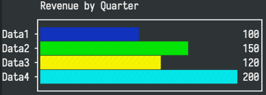 |
| `COLUMNPLOT` | 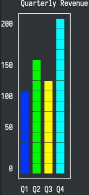 |
| `LINEPLOT` | 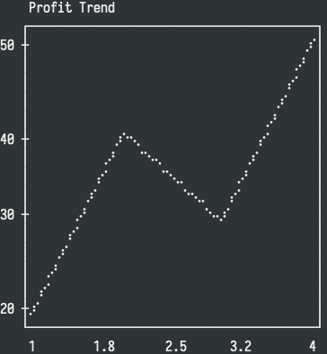 |
| `SCATTER` | 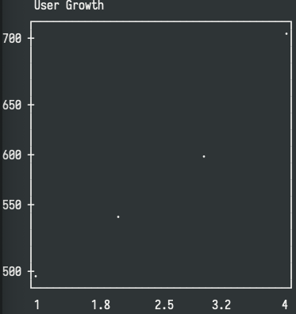 |
| `HISTOGRAM` | 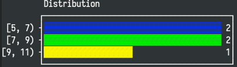 |
| `BOXPLOT` | 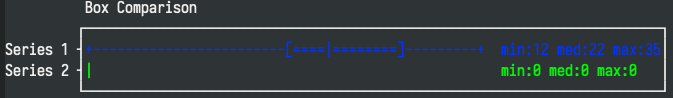 |
| `DENSITY` | 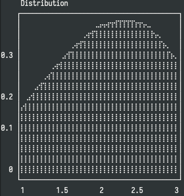 |
| `COUNTPLOT` | 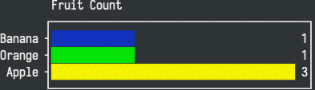 |
| `MULTILINE` | 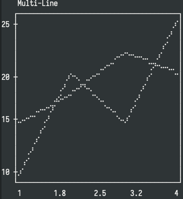 |
| `SPARKLINE` |  |

### 图表演示文件

查看 `examples/chart-gallery.grid` 获取完整演示：

```elisp
(:title "图表展示"
 :headers ("类型" "数据1" "数据2" "数据3" "数据4" "图表")
 :rows (
   ("收入" "100" "150" "120" "200" "=BARPLOT(B1:E1, B2:E2, \"收入\")")
   ("趋势" "20"  "40"  "30"  "50"  "=LINEPLOT(B1:E1, B3:E3, \"趋势\")")
   ("迷你" "10"  "12"  "11"  "15"  "=SPARKLINE(B4:E4)")
 ))
```

## 🔗 格式集成教学指南

### Org模式深度集成

```org
#+BEGIN: grid-table
#+OPTIONS: :file "~/项目/数据.grid" :width 800 :height 400

**这里显示表格预览** (静态只读)

#+END:
```

**三步操作**:

1. `M-x grid-table-org-insert-block` - 插入专用区块
2. `M-x grid-table-org-refresh-block` - 重新渲染预览
3. `M-x grid-table-org-open-block` - 打开编辑窗口 (隐藏预览)

### Markdown GitHub风格

````markdown
```grid-table
:file ~/项目/数据.grid
:width 100%
```
````

**专用预览区域** (安全只读)

```

```

</markdown>

### reStructuredText支持

| 🎯 场景          | 📝 命令                                     | 📤 结果         |
| ---------------- | ------------------------------------------- | --------------- |
| 从grid导出       | `M-x grid-table-export-as-rst`              | 📄 标准RST格式  |
| 插入现有机构文件 | `M-x grid-table-rst-insert-table-from-file` | 🔗 智能路径识别 |

### Excel 工作簿（xlsx）

`(require 'grid-table-xlsx)` 提供两个命令：

| 命令 | 作用 |
| ---- | ---- |
| `M-x grid-table-xlsx-find-file` | 把工作簿打开为表格，工作簿里的每张工作表各成一张表 |
| `M-x grid-table-xlsx-export` | 把表格连同它的全部工作表写入工作簿 |

值、公式、合并单元格、加粗、斜体、文字颜色、填充色、对齐和条件格式可以双向往返。工作表的第一行成为表头行。从工作簿打开的表格不与该文件绑定：`C-c C-w` 保存的是 `.grid` 文件，导出才写回工作簿。

不能往返的内容：

- 日期、百分比、货币金额和固定小数位的数字连同格式双向往返，存的都是数值。grid-table 没有对应的数字格式（科学计数法、月份名称、带引号的单位等）按常规格式显示，写回时原样保留。看起来像数字的文本（如 `007`）保持为文本，导入后是 `'007`。第一行向下合并的工作表（如跨两行的标题）会按「无表头行」打开，以保留这个合并。1900 年 3 月之前的日期会差一天，因为工作簿的日历里那一年有 2 月 29 日。
- 列宽和冻结的行列双向往返：工作簿里设过的列宽成为手动列宽，表格里手动调过的列宽写回工作簿，其余列保持工作簿原有的宽度；冻结窗格以表格为准，取消冻结也会写回。表格里的列宽是整数个字符，往返后可能有取整。
- 边框、字体，以及比较、「文本包含」、「为空」、「是错误值」之外的条件格式，导入时会被略去。导出时该工作表的单元格、合并和条件格式会被表格里的内容替换，所以其中被略去的部分会消失；这张表的其余设置保持原样，其他工作表不受影响。
- 用到 grid-table 没有的函数的公式，在表格里显示为错误值；公式本身原样保留，导出时不变。
- 写回打开时的那个工作簿时，文件里的工作表以表格为准：在表格里删除或改名的工作表会从文件里消失。写入另一个工作簿时，表格的工作表被加进去，那个工作簿原有的工作表保留。
- 图表公式导出为文本。

文件格式由一个 Rust 写的动态模块处理（`plugins/xlsx/`），所以 Emacs 需要带模块支持。`plugins/` 里带有 macOS 的预编译模块（`grid-table-xlsx-module.dylib`，同时支持 Apple 芯片和 Intel），直接加载即可。其他平台用 `M-x grid-table-xlsx-build-module` 或 `make module` 自行编译，编译需要 cargo。自己编译的模块优先于预编译的；模块放在别处时用 `grid-table-xlsx-module-file` 指定。

## 核心技术原理

### 数据流架构图

```
用户界面 ←→ grid-table.el ←→ 核心引擎
                ↓                ↓
          data-source API ← grid-data-model
                ↓                ↓
        CSV插件 ←→ Org插件 ←→ 自定义数据源
```

### 🔑 核心API速查表

| 🤝 接口类型  | 🔗 键值                    | 📝 返回值类型 | 💡 关键用途    |
| ------------ | -------------------------- | ------------- | -------------- |
| **数据获取** |                            |               |                |
| 原始值       | `:get-raw-value-at`        | String        | 公式前的值     |
| 计算值       | `:get-computed-value-at`   | Any           | 公式计算结果   |
| **结构管理** |                            |               |                |
| 维度查询     | `:get-row-count`           | Integer       | 导入数据统计   |
| 新增单元     | `:add-row` / `:add-column` | Boolean       | 成功/失败      |
| **扩展接口** |                            |               |                |
| 加载接口     | `:load-from-file`          | Object        | 自定义文件支持 |
| 保存接口     | `:save-to-file`            | Boolean       | 格式导出逻辑   |

## 📁 代码组织结构

```
grid-table/                    # 项目根目录
├── grid-table.el              # 主入口 + UI渲染
├── grid-data-model.el         # 数据模型核心
├── grid-data-source.el        # 数据源抽象
├── grid-table-api.el          # 公开API
├── grid-table-calc.el         # 公式计算引擎
├── grid-table-chart.el        # 图表可视化引擎
├── grid-table-nav.el          # 导航控制逻辑
├── grid-table-parser.el       # 文本解析工具
└── grid-table-persistence.el  # 持久化支持
├── plugins/                   # 插件扩展系统
│   ├── grid-table-csv.el      # CSV格式支持
│   ├── grid-table-xlsx.el     # Excel 工作簿支持
│   ├── xlsx/                  # xlsx 模块的 Rust 源码
│   ├── grid-table-org.el      # Org模式集成
│   ├── grid-table-markdown.el # Markdown集成
│   ├── grid-table-rst.el      # reStructuredText导出
│   └── grid-table-example-plugin.el # 插件开发示例
├── examples/                  # 示例文件
│   └── chart-gallery.grid     # 图表演示
├── docs/                      # 技术文档
│   ├── ELISP_FORMULA_GUIDE.md     # 公式开发指南
│   └── PLUGIN_DEVELOPMENT.md      # 插件开发手册
└── pictures/                  # 产品截图和演示
```

## 🤝 如何贡献力量

### ⚡ 插件开发快速入门

#### 3种插件类型（1分钟掌握）

| 🎯 类型             | 📝 功能说明          | 🎯 适用场景        |
| ------------------- | -------------------- | ------------------ |
| 🎨 **单元格渲染器** | 自定义单元格显示外观 | 进度条、货币格式等 |
| 📊 **数据源插件**   | 支持新的文件格式     | JSON、Excel读取    |
| ⚡ **功能插件**     | 添加新功能命令       | 数据导出、图表生成 |

#### 快速开始模板（复制即可用）

```elisp
;;; my-plugin.el --- 快速模板 -*- lexical-binding: t -*-
(require 'grid-table-plugins)

;; 简单的货币格式化渲染器
(defun my-currency-renderer (value &optional cell-props)
  "货币格式化渲染器，将数字转为 ¥XX.XX 格式"
  (if (and value (stringp value))
      (let ((num (string-to-number value)))
        (format "¥%.2f" num))
    ""))

;; 注册渲染器（完成！）
(defun my-plugin-init ()
  (grid-table-register-cell-renderer 'currency #'my-currency-renderer)
  (grid-table-register-plugin 'my-plugin))

(my-plugin-init)
(provide 'my-plugin)
```

> 📚 **完整开发指南**→ [插件开发手册](docs/PLUGIN_DEVELOPMENT.md) (从入门到专家级)

### 快速反馈路径

- **Bug报告** → [GitHub Issues](https://github.com/your-repo/issues)
- **功能建议** → [讨论论坛](https://github.com/your-repo/discussions)
- **插件贡献** → [插件开发手册](docs/PLUGIN_DEVELOPMENT.md)

### 🎯 社区贡献方向

| 🎯 类型        | 📋 需求描述                | 🏷️ 标签                 |
| -------------- | -------------------------- | ----------------------- |
| **数据源插件** | Excel/JSON/数据库数据源    | `enhancement`, `plugin` |
| **格式导出**   | LaTeX/ASCII/HTML/JSON 导出 | `extending`, `format`   |
| **主题插件**   | 深色模式                   | `UI/UX`, `theme`        |
| **图表插件**   | 数据可视化                 | `visualization`         |

---

<div align="center">

**用 ❤️ 为 Emacs 社区打造**

_自 2025 年来支持高效生产力工作流_

🤝 **[→ 加入开发者社区 ←](https://github.com/yibie/grid-table/discussions)**

</div>
